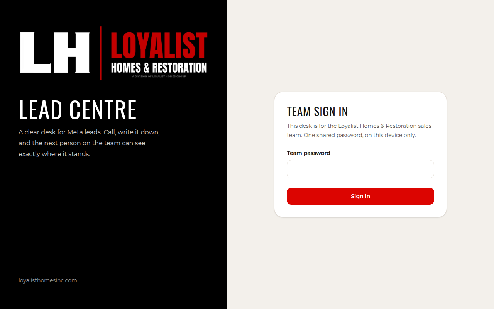
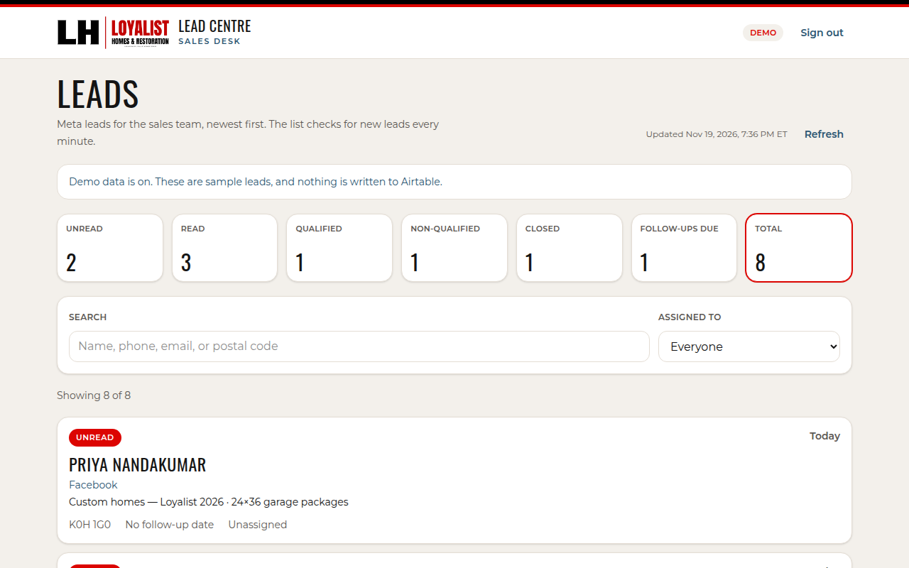
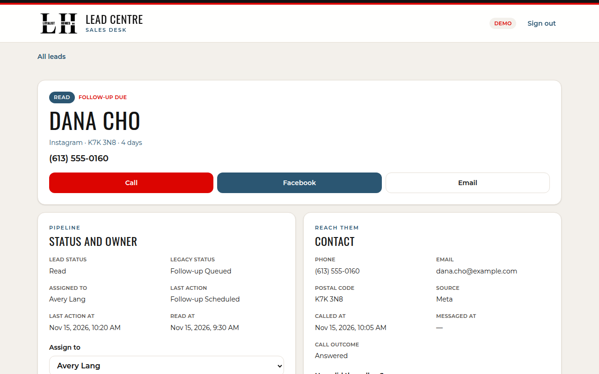
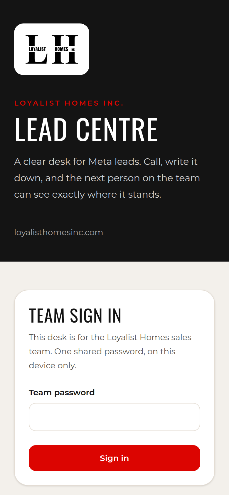
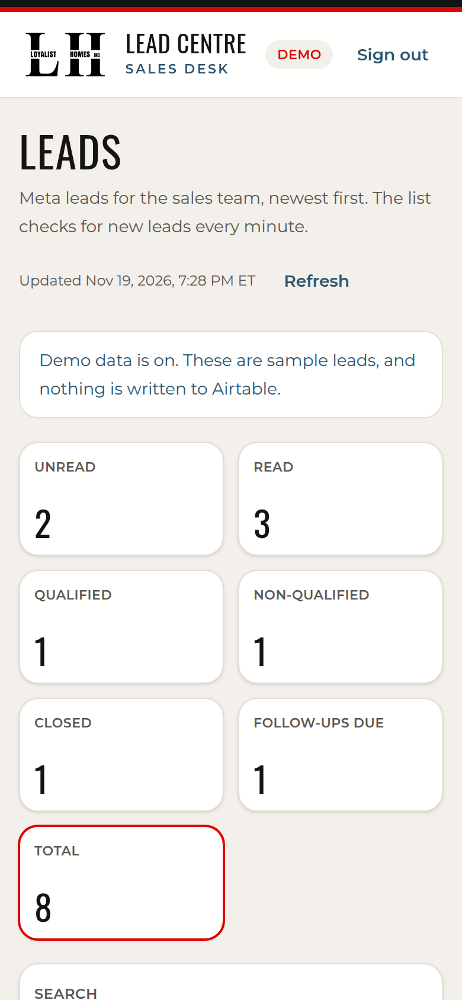
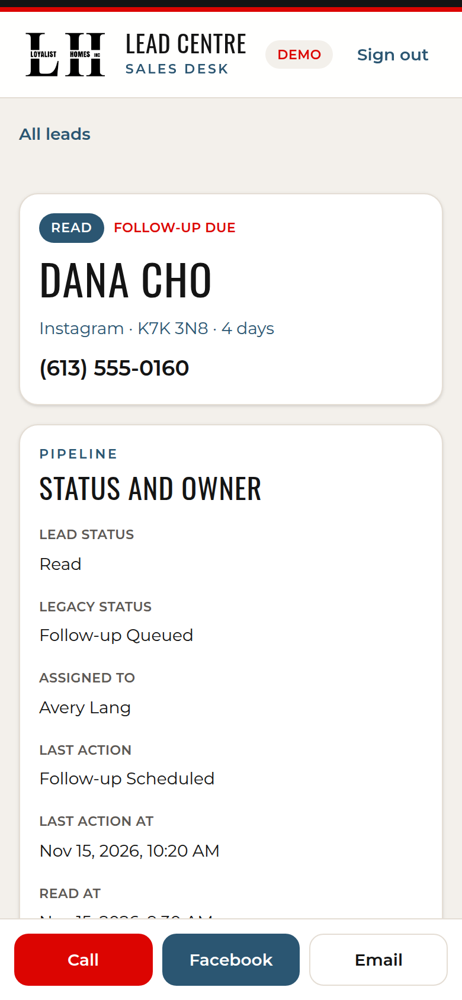

# Rural Building Solutions Lead Centre

Sales desk for Meta ad leads. The team signs in with a shared password, works the Leads table in Airtable, and can run the same screens with sample data when no token is available.

New Meta leads are created in Leads by an Airtable automation. This app does not write to the META Leads table. It only reads and writes Leads (`tbl8sXU8IpSP5fGHt`) in the Lead Pipeline base (`app6E9VKmqQAaAu4j`), using field names. Select options (call outcome, close outcome, non-qualified reason, and the rest) are loaded from the Airtable metadata API at runtime.

Times are shown in America/Toronto.

## Demo mode

Demo mode renders sample leads and does not call Airtable, so you can click through the desk without a token.

```bash
cp .env.example .env.local
```

In `.env.local`:

```bash
DEMO_MODE=true
```

If `TEAM_PASSWORD` is empty, the password is `loyalist`. If `SESSION_SECRET` is empty, a demo-only signing secret is used. Do not deploy with `DEMO_MODE=true`.

```bash
npm install
npm run dev
```

Open [http://localhost:3000](http://localhost:3000). The dashboard refreshes about once a minute. Opening an Unread lead marks it Read and sets Read At.

## Demo screenshots

Desktop:





Phone:





## Airtable token

1. Open [airtable.com/create/tokens](https://airtable.com/create/tokens).
2. Name the token something like `Loyalist Homes Lead Centre`.
3. Add these scopes:
   - `data.records:read`
   - `data.records:write`
   - `schema.bases:read`
4. Under Access, add **only** the Lead Pipeline base (`app6E9VKmqQAaAu4j`). Airtable grants a token to a whole base, not one table. This app still refuses every table except Leads, including META Leads.
5. Create the token and copy it once. It is the `AIRTABLE_TOKEN` value.

`schema.bases:read` is what lets the app load single-select options (and see which fields exist) from `GET /v0/meta/bases/{baseId}/tables`. Missing fields are skipped instead of breaking the page. `Assigned To` is an Airtable collaborator field, so the assign list is people already present on Leads, not a hardcoded roster.

## Environment variables

| Name | Where | Purpose |
| --- | --- | --- |
| `AIRTABLE_TOKEN` | Server only | Airtable personal access token |
| `AIRTABLE_BASE_ID` | Server only | `app6E9VKmqQAaAu4j` |
| `LEADS_TABLE_ID` | Server only | `tbl8sXU8IpSP5fGHt` |
| `TEAM_PASSWORD` | Server only | Shared sales-team password |
| `SESSION_SECRET` | Server only | Signs the `lh_session` httpOnly cookie |
| `DEMO_MODE` | Server only | `true` uses sample leads and never calls Airtable |

Do not put the token, password, or session secret in `NEXT_PUBLIC_` variables. The browser talks only to the Next.js API routes.

## Local live data

```bash
cp .env.example .env.local
```

Fill in `AIRTABLE_TOKEN`, `TEAM_PASSWORD`, and `SESSION_SECRET`. Leave `DEMO_MODE` empty. Then `npm run dev`.

## Deploy on Vercel

The app is a Next.js App Router project. Vercel detects the framework.

1. Push this repository to GitHub.
2. In Vercel, choose **Add New Project** and import the repository.
3. Framework preset: Next.js. Build command `npm run build`. Output is the Next.js default.
4. Add the environment variables above for Production and Preview. Set `DEMO_MODE` to empty or `false`. Use a long random `SESSION_SECRET` (for example `openssl rand -base64 32`).
5. Deploy. Later changes on the connected branch deploy automatically.

The session cookie is `httpOnly`, `SameSite=Lax`, and `Secure` in production. It lasts 7 days.

## Swapping the login later

The password check lives in `lib/password.ts`. A valid sign-in calls `issueSessionToken` in `lib/session.ts`, which sets a signed httpOnly cookie. Pages and API routes only ask `readSession` / `requireSession` whether that cookie is valid.

To plug this into Loyalist Homes OS or an SSO provider, replace the login route with the provider callback and issue a session (today the subject is `"team"`; it can become a user id). The dashboard, lead routes, and `proxy.ts` gate can stay as they are.

## Reports

`/reports` summarizes response speed for the signed-in team. The default range is the last 30 days. A lead counts as contacted at the earliest of Called At, Messaged At, and Emailed At. Created time is Meta Created At, then a parseable Lead Created Time, then the Airtable record time. Rates show n/a when the range has no leads.

## What the desk writes

Actions update Leads only, with `typecast: true` where a select or collaborator value is sent:

- Opening an Unread lead sets Lead Status to Read, Read At, and Last Action to Marked Read, and prepends `Status changed: Unread -> Read` to Activity Log.
- Mark as Unread sets Lead Status back to Unread, logs the change, and returns to the lead list so opening the record does not immediately mark it Read again.
- Status buttons, call outcomes, estimates, follow-up dates, assignment, and notes each prepend a timestamped Activity Log line and update Last Action and Last Action At.
- Call opens the `tel:` link immediately, then records Called At, Last Action `Called`, Last Action At, and Lead Status Called. The line is prepended to Activity Log.
- Reply on Facebook opens the inbox in a new tab and records Messaged At, Last Action `Messaged on Facebook`, and Last Action At.
- Email opens `mailto:` and records Emailed At, Last Action `Emailed`, Last Action At, and Lead Status Emailed. Facebook does not change Lead Status.
- Each of those three clicks is logged with `typecast: true` through `POST /api/leads/[id]/action`. The call-outcome buttons still set Call Outcome and the matching Last Action (`Called - Answered`, `Called - No Answer`, `Left Voicemail`, and any other options Airtable returns).
- Qualified, Non-Qualified (with a reason), and Closed (Won or Lost) update Lead Status.
- Estimate sent sets Estimate Sent At and, if you enter one, Estimate Amount.
- Follow-up date writes Follow-up Date.
- Add note appends a timestamped line to Notes. It does not replace what is already there.

Formula fields (Call, Reply on Facebook, Email Link, Open META Record, Platform Name, Days Since Lead, Follow-up Due) are read-only.

## Scripts

```bash
npm run dev
npm run build
npm run start
npm run lint
```
